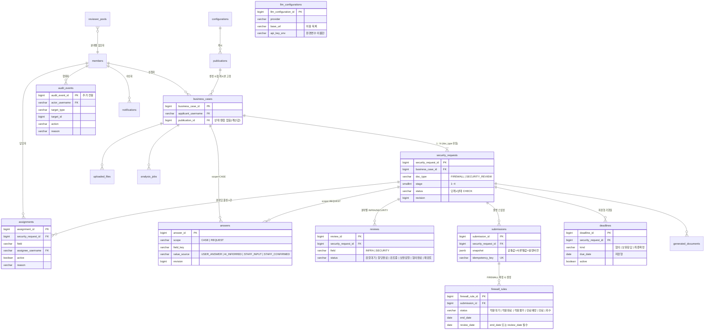

# Security-Advisor-Back

보안길잡이(SecurityAdvisor) 백엔드 — Spring Boot 4.1 · Java 25 · PostgreSQL 17 · Flyway · Gradle(Kotlin DSL) · Lombok(허용 목록만, `lombok.config`로 강제).
작업 전 [PROJECT_CONTEXT.md](PROJECT_CONTEXT.md) 5장의 **공식 기준 버전 표**와 참조 문서의 머리말 버전·개정일을 확인한다. 문서별 참조 순서는 [claude/INSTRUCTIONS.md](claude/INSTRUCTIONS.md)를 따른다.

업무 규칙은 [FUNCTIONAL_SPEC.md](FUNCTIONAL_SPEC.md), 개발 실행 규칙은 [AGENTS.md](AGENTS.md), 문서 개정 절차는 [PROJECT_RULES.md](PROJECT_RULES.md) 7-1장, 협업·수용 기준은 [CONTRIBUTING.md](CONTRIBUTING.md)를 따른다. 코드 작성은 [CODING_STYLE.md](CODING_STYLE.md)와 [SECURE_CODING.md](SECURE_CODING.md), 화면 기준은 [design.md](design.md)를 함께 확인한다. 동기화에 사용한 원본과 남은 차이는 [문서 출처 기록](docs/SOURCE_PROVENANCE.md)에 정리한다.

```bash
python3 tools/check_doc_versions.py   # 공식 기준 표·머리말 버전·개정일·문서 경로 검사
```

구조·의존 방향·주요 흐름·확장 포인트는 [docs/ARCHITECTURE.md](docs/ARCHITECTURE.md), 프론트 연동 안내는 [docs/FRONTEND_HANDOFF.md](docs/FRONTEND_HANDOFF.md)를 참고한다. 실제 스택·스키마 결정은 [ADR 0001](docs/adr/0001-stack-and-schema-conventions.md), REST API 결정은 [ADR 0004](docs/adr/0004-restful-api-and-error-model.md)에 있다. 기존 [ADR](docs/adr/)과 [docs/DEVIATIONS.md](docs/DEVIATIONS.md)의 결정·구현 차이 기록은 보존하며, 원본 규칙과 정리되지 않은 차이는 PROJECT_RULES.md 7-1 절차로 반영한다.

담당자는 현재 역할의 활성 배정 신청만 조회하며, 기관 통계는 관리자 전용이다. 계정 비활성화·역할 변경 후 기존 세션은 재로그인이 필요하다. [권한 결정](docs/adr/0010-assigned-access-and-session-revocation.md)과 [도커 검증 결과](docs/ACCESS_SESSION_20261110.md)를 참고한다.

계정·역할·분야 등록이 바뀌면 진행 중 신청에 재배정 필요를 표시하고, 관리자가 사유를 남겨 후임에게 인계한다. 담당자 등록과 기본 지정, 자동 배정의 부적격 후보 처리 및 검증 결과는 [업무 인계 기록](docs/ASSIGNMENT_HANDOFF_20261110.md)에 정리한다.

## 준비물

- JDK 25 (없으면 Gradle toolchain이 자동으로 내려받는다)
- Docker (개발용 DB와 테스트의 Testcontainers에 필요)
- PostgreSQL 17 — `jdbc:postgresql://localhost:5432/boan` (계정 `boan`/`boan`, `DB_URL`·`DB_USERNAME`·`DB_PASSWORD`로 변경)

## 실행

```bash
cp .env.example .env         # 시연 계정 비밀번호(DEMO_ACCOUNT_PASSWORD) 등 — .env 는 커밋하지 않는다
./gradlew bootRun            # http://localhost:8080 , Swagger UI: /swagger-ui.html
./gradlew spotlessApply check  # 커밋 전 필수: 포맷 + 테스트 + ArchUnit
```

기동 시 `DemoAccountSeeder` 가 역할별 시연 계정 5건(`applicant`·`applicant2`·`security`·`infra`·`admin`, 비밀번호는 `DEMO_ACCOUNT_PASSWORD`)을 bcrypt 해시로 만든다. 비밀번호를 비우면 만들지 않는다. 마이그레이션에는 계정을 넣지 않는다.

### Docker 만으로 실행 (compose)

```bash
cp .env.example .env            # 시연 비밀번호·기관명·LLM 키(선택) 채우기
docker compose up -d --build    # db(PostgreSQL 17) + app
# http://localhost:8080/swagger-ui.html
docker compose --profile ollama up -d --build   # 공개 모델(Ollama) 도 함께 — 이후 docker compose exec ollama ollama pull exaone3.5:7.8b
docker compose down -v          # 시연 데이터 초기화
```

완성본·제출용 실행은 Security-Advisor 저장소의 compose(Back + Front + DB)가 맡는다. CI(`.github/workflows/check.yml`)는 push·PR 마다 `python3 tools/check_doc_versions.py`와 `./gradlew check` 를 돌린다.
API 계약 파일은 `docs/api/openapi.yaml`(생성 방법은 `docs/api/README.md`).

## 사업 건·신청 API (F-01·F-03·F-05 일부)

| 요청 | 설명 | 응답 |
|---|---|---|
| `GET /api/publications/current` | 현재 게시본 — 서류 유형 목록(`docTypes`)과 질문 항목(`fields`). 서류 유형은 코드가 아니라 이 데이터가 정한다(ADR 0005) | 200 |
| `POST /api/business-cases` | 사업 건 + 선택한 서류 유형별 신청 생성. `docTypes` 는 현재 게시본 `docTypes` 의 활성 코드(문자열). 사업명·개요·부서는 공통 답변으로, 담당자 항목은 "담당자 확인 필요"로 미리 생성 | 201 + `Location`, 유형 없음 400, 게시본에 없는 유형 422 |
| `GET /api/business-cases?page&size` | 내 사업 건 목록(진행 요약은 하위 신청에서 계산) | 200 |
| `GET /api/security-requests?status&docType&page&size` | **내 신청 목록**(역할별): 신청자는 자기 사업 건의 신청, 담당자는 내게 활성 배정된 신청, 관리자는 전체. 사업 건 제목·부서 포함, 최근 수정순 | 200, 상태 이름 오류 400 |
| `PATCH /api/business-cases/{id}/answers` / `PATCH /api/security-requests/{id}/answers` `{answers:[{fieldKey,value,expectedRevision?}]}` | **답변 일괄 저장** — 항목마다 `PUT …/answers/{key}` 와 같은 규칙, 한 트랜잭션(하나라도 실패하면 전부 취소) | 200(저장된 답변 목록) |
| `POST /api/business-cases/{id}/security-requests` `{docType}` | **기존 사업 건에 서류 추가**(F-01 P2): 공통 답변·문서를 공유하는 새 신청이 1단계로 생긴다(게시본은 사업 건 생성 시점 것). 같은 유형의 진행 중 신청이 있으면 422 | 201 |
| `POST /api/doc-type-suggestions` `{summary?, businessCaseId?}` | **AI 서류 유형 제안**(F-01): 개요·문서 AI 요약을 근거로 게시본의 활성 유형 중 필요한 것을 근거·확신도와 함께 제안(제안만, 선택은 사용자). 목록에 없는 유형은 버림 | 200, 둘 다 없음 400, 모델 실패 503 |
| `GET /api/business-cases/{id}` | 사업 건 상세 + 공통 답변 + 신청 요약 | 200, 남의 것 404 |
| `PUT /api/business-cases/{id}` | 사업 개요 수정(`expectedRevision`) | 200, 불일치 409 |
| `PUT /api/business-cases/{id}/answers/{fieldKey}` | 공통 항목 사용자 답변(처음이면 `expectedRevision` 생략) | 200, 스키마에 없는 항목 404, 범위 불일치 422 |
| `PUT …/answers/{fieldKey}/confirmation` | AI 제안 값 사용자 확인 | 200 |
| `PUT …/answers/{fieldKey}/staff-check` | 담당자 확인 요청으로 넘김 | 200 |
| `GET /api/security-requests/{id}` | 신청 상세 + 서류별 답변 | 200, 남의 것 404 |
| `PUT /api/security-requests/{id}/answers/{fieldKey}` (+`/confirmation`, `/staff-check`) | 서류별 항목 답변·확인·담당자 확인 요청 | 위와 같음, 제출·종결·철회 후 422 |
| `PUT /api/security-requests/{id}/withdrawal` | 신청 철회(사유 필수) | 200, 종료 상태 422 |

## 협의 요청·배정·기한·감사 API (F-12·F-13·F-14 + 2단계 진입)

| 요청 | 설명 | 응답 |
|---|---|---|
| `POST /api/security-requests/{id}/reviews` | **협의 요청(1→2단계)**: 분야별 협의 생성 + 기본 담당자 자동 배정(같은 사업 건은 같은 담당자 우선, 신청자 본인 제외) + 협의 기한(영업일) 생성 + 감사 이력, 한 트랜잭션 | 201(미배정 분야 목록 포함), 1단계 아님 422, revision 409 |
| `GET /api/security-requests/{id}/reviews` | 분야별 협의 목록 | 200 |
| `GET /api/security-requests/{id}/assignments` | 배정 이력(활성·비활성) | 200 |
| `POST /api/security-requests/{id}/assignments` | 재배정·미배정 수동 배정(기관 관리자, 사유 필수, 담당자 목록의 활성 구성원만). 이전 배정은 비활성으로 보존 | 201, 관리자 아님 403, 규칙 위반 422 |
| `GET /api/assignments/mine` | 내게 배정된 활성 배정(요청함 기본 보기) | 200 |
| `GET /api/reviewer-pools?field` | 분야별 담당자 목록(기관 관리자, 비활성 포함) | 200, 관리자 아님 403 |
| `POST /api/reviewer-pools` | 담당자 등록(`field`·`memberUsername`·`defaultReviewer`). 계정이 활성이고 분야 역할(INFRA/SECURITY)이어야 한다. 비활성으로 남아 있던 등록은 재활성화 | 201 + `Location`, 역할 불일치·중복 422 |
| `PUT /api/reviewer-pools/{id}/default` | 기본 담당자 지정 — 이전 기본은 해제(분야당 활성 기본 1명). 멱등 | 200, 비활성 422 |
| `PUT /api/reviewer-pools/{id}/activation` | 활성/비활성 설정(`active`·`reason`). 비활성화는 기본 지정을 풀고 **배정은 바꾸지 않으며** `reassignmentNeededRequestIds`(그 사람의 활성 배정이 남은 신청)를 돌려준다 → 관리자가 재배정 | 200 |
| `GET /api/todo-summary` | **처리할 일 n건** 배지 — 역할별 집계(담당자: 협의 대기·답변된 보완·내 분야 최종 확인 대기 / 신청자: 미해결 보완·3단계 최종 검토 / 관리자: 미배정 신청) + `total` | 200 |
| `GET /api/security-requests/{id}/deadlines` | 기한 목록. `status`(ON_TRACK·IMMINENT·OVERDUE·ENDED)는 오늘(Asia/Seoul) 기준 계산값. **보완 대기 중 담당자 협의 기한은 정지**(`paused:true`, `remainingBusinessDays` 보관)되고 답변 시 남은 영업일로 새 기한이 생긴다(F-13 P3) | 200 |
| `GET /api/deadline-reminder-schedule` / `PUT …` `{"cron","enabled"}` | **기한 알림 스케줄**(기관 관리자): Spring 6필드 cron(Asia/Seoul)과 사용 여부. DB(`reminder_schedules`)에 저장되고 **저장 즉시 반영(재시작 불필요)**, 응답에 다음 실행 시각. 기본 매일 08:10 | 200, cron 형식 오류 422 |
| `POST /api/deadline-reminder-runs` | **기한 알림 수동 실행**(기관 관리자, `asOf` 선택). 위 스케줄로 자동 실행되는 것과 같은 일을 한다: 활성 기한 중 **1영업일 전**(DEADLINE_IMMINENT)·**경과**(DEADLINE_OVERDUE) 알림을 담당자(협의·최종 확정)·신청자(보완 응답)에게 보낸다. 기한·종류당 한 번만, 업무 상태는 바꾸지 않는다 | 201(검사·임박·경과 건수), 관리자 아님 403 |
| `GET /api/security-requests/{id}/audit-events` | 처리 이력(이 신청을 대상으로 한 감사 이력, 시간순). 상태 전이·답변·배정·보완·반환·제출·확정 외에 **AI 호출**(LLM_CALLED/LLM_CALL_FAILED: 구성·용도·소요 시간·응답 길이, 원문 없음)과 **서류 다운로드**(DOCUMENT_DOWNLOADED)도 남는다. 비공개 컨텍스트 조회·검색은 PRIVATE_CONTEXT_VIEWED 로 건수만 기록(관리자 전체 조회에서 확인) | 200 |
| `GET /api/audit-events?targetType&targetId&page&size` | 기관 관리자 전체 감사 조회 | 200, 관리자 아님 403 |

- 모든 응답에 `X-Request-Id` 헤더가 붙고, 오류 ProblemDetail 과 감사 이력의 `requestId` 가 같은 값이다.
- 감사 이력은 업무 변경과 같은 트랜잭션에서 기록되며(기록 실패 = 업무 실패), `audit_events` 는 DB 트리거로 UPDATE·DELETE 를 거부한다. 값·비밀값·원문은 기록하지 않고 항목 키·출처·참조 ID 만 남긴다.
- 기한 정책(영업일 수·공휴일·임박 기준)은 게시본 `deadlinePolicy` 에 있고 사업 건 생성 시점 버전으로 고정된다. 기한 경과는 상태를 바꾸지 않는다.

## 담당자 검토·보완·반환·종결 API (F-04·F-05)

검토 행위는 **그 신청·분야에 활성 배정된 담당자**만 할 수 있다(역할만 맞으면 403). 조회는 신청을 볼 수 있는 사람 누구나. 협의·보완·신청의 `revision` 은 각각 따로 움직이므로 요청 전에 `GET` 으로 최신 값을 읽는다.

| 경로 | 설명 | 응답 |
| --- | --- | --- |
| `GET /api/reviews?status&requestStatus&field&docType&keyword` | **담당자 요청함** — 내게 활성 배정된 신청의 협의(사업 건 제목·신청자·협의 기한일·미해결 보완 수·같은 사업 건의 다른 신청 `siblingRequests` 포함). 조건은 모두 선택이며 AND; `keyword`는 제목·신청자 아이디·신청 번호 부분 일치 | 200, 상태 이름 오류 400 |
| `GET /api/reviews/{id}` | 협의 상세(할당 여부·체크리스트·의견) | 200 |
| `PUT /api/reviews/{id}/answers/{fieldKey}` | **담당자 입력**(출처 STAFF_INPUT) — 예: INFRA 가 출발지·목적지·대상 서버를 할당. scope=CASE 항목은 사업 건에 저장되어 같은 사업 건의 다른 신청에도 보인다. 2단계 협의 중인 신청만 | 200, 미배정 403, 항목 없음 404, 2단계 아님 422 |
| `PUT /api/reviews/{id}/answers/{fieldKey}/confirmation` | **담당자 확인**(출처 STAFF_CONFIRMED) — 사용자 답변·AI 추론 값이 맞다고 확인. 값은 바뀌지 않는다 | 200, 답변 없음 404 |
| `PUT /api/reviews/{id}/allocation-completion` | **INFRA 할당 완료** — 협의 완료가 아니다(불변식 12). SECURITY 완료의 선행 조건 | 200, SECURITY 협의 422 |
| `PUT /api/reviews/{id}/completion` | **분야 협의 완료** — 의견 필수, 분야 체크리스트 전부 `true`(INFRA: source·destination·protocol·port·period / SECURITY: processed_info·external_transfer·access_control·logging), 미해결 보완 없음, SECURITY 는 INFRA 할당 완료 이후. 필요한 분야가 모두 완료되면 신청이 **3단계 최종 검토**로 넘어가고 협의 기한이 종료된다 | 200, 규칙 위반 422, revision 409 |
| `PUT /api/supplements/{id}/resolution` `{note?, expectedRevision}` | **보완 해소**(그 분야 배정 담당자): 답변된 보완을 검토 완료로 표시. 협의 완료 시 자동 해소와 별개의 명시적 경로, 멱등 | 200 |
| `POST /api/reviews/{id}/supplements` | **보완 요청** — 대상 항목 1개 이상 + 사유 필수. 신청 상태 → 보완 요청(단계 유지), 대상 답변 `needsReview=true`(값 보존), 보완 응답 기한 재산정 | 201 + `Location`, 완료된 협의 422 |
| `POST /api/supplements/{id}/answers` | **신청자 보완 답변** — 항목 값은 답변 API 로 먼저 고친 뒤 호출. 협의의 미해결 보완이 없으면 협의·신청 상태가 원래대로, 보완 응답 기한 종료 | 201, 남의 신청 404, 본인 아님 403 |
| `GET /api/security-requests/{id}/supplements` | 보완 요청 목록 | 200 |
| `POST /api/security-requests/{id}/stage-returns` | **차수 반환**(2→1, 3→2, 3→1, 4→3) — 사유 필수, `fieldKeys` 로 지정한 항목만 "보완 필요" 강조(기존 값 보존), `fieldReasons`(항목 키→항목별 사유, 선택 — 키는 지정 항목에 자동 포함), 완료된 협의는 재검토(RECHECK)로, 협의·최종 확정 기한 종료 + 보완 응답 기한 생성. 어느 분야든 배정 담당자 | 201, 허용되지 않는 반환 422 |
| `GET /api/security-requests/{id}/stage-returns` | 차수 반환 이력(신청 단위 사유 + 항목별 사유) | 200 |
| `PUT /api/security-requests/{id}/closure` | **종결(반려)** — 사유 필수, 모든 활성 기한 종료, 이후 전이 불가. 같은 사업 건의 다른 신청은 영향 없음 | 200, 종료 상태 422 |

- 사용자가 답변을 바꾸면(`PUT …/answers/{fieldKey}`) 영향받는 미제출 신청의 **완료된 협의가 재검토로** 돌아간다(불변식 7). request 컨텍스트가 `AnswerChangedEvent` 를 내고 review 컨텍스트가 같은 트랜잭션에서 받는다.
- 보완 답변·협의 완료 시 ANSWERED 보완은 RESOLVED 로 해소된다. 제출(F-07)은 OPEN 보완이 없어야 한다.

## 제출·최종 확인·확정·문서함 API (F-07)

| 경로 | 설명 | 응답 |
| --- | --- | --- |
| `POST /api/security-requests/{id}/submissions` + 헤더 `Idempotency-Key` | **제출**(3단계 최종 검토 중, 신청자 본인). 제출 전 검사 전부 통과해야 함 — 필수값 완료·미확정 값 없음·미해결 보완 없음·필요 분야 협의 완료. 그 시점의 공통 값 + 서류별 값 + 설정 버전을 불변 스냅샷으로 저장하고 최종 확정 기한 생성. 같은 키 재요청은 기존 제출본 반환 | 201 + `Location` / 같은 키 200, 키 없음 400, 검사 실패·3단계 아님 422(detail 에 항목 키), revision 409 |
| `GET /api/security-requests/{id}/submissions` | 신청의 제출본 개정 목록(최근 먼저, `latest` 표시) | 200 |
| `GET /api/submissions/{id}` | 제출본 상세(스냅샷 포함) | 200, 남의 것 404 |
| `GET /api/submissions?docType&status&latestOnly` | **문서함** — 신청자는 자기 사업 건, 담당자·관리자는 전체. 각 줄에 신청·사업 건 현재 상태 포함(확정 여부 = 신청 상태 `CONFIRMED`) | 200 |
| `POST /api/submissions/{id}/final-confirmations` | **분야 최종 확인**(4단계, 호출자 역할이 분야). 배정 담당자만, INFRA 선행, 분야당 1건, 최신 제출본만 | 201, SECURITY 선행 시도·중복 422, 미배정 403 |
| `GET /api/submissions/{id}/final-confirmations` | 최종 확인 목록 | 200 |
| `PUT /api/submissions/{id}/confirmation` | **확정** — 배정된 SECURITY 담당자만, 두 분야 최종 확인 이후. 신청 상태 → `CONFIRMED`(종료, 이후 전이 불가), 최종 확정 기한 종료 | 200, 두 분야 미확인 422, INFRA·신청자 403 |

- 부족하면 4→3 차수 반환(`POST …/stage-returns`)으로 돌려보내고, 다시 제출하면 새 개정본(`sequenceNo` 증가)이 된다. 이전 제출본은 불변·조회만.
- 서류 확정 ≠ 방화벽 적용. 방화벽 규칙 생성(불변식 26)·적용 기록은 policy 컨텍스트(F-15)에서 추가한다 — 미구현.
- 3단계 최종 보고서는 AI 생성 또는 직접 작성 → 수정·확인 → 제출 순서로 처리한다. 한 번 생성한 초안은 최신 원본 기준으로 확인되어야 제출할 수 있다. 제출본에는 최종 서술·AI 원문·출처·모델·확인자를 답변과 함께 보존한다. 서술 없는 기존 API 신청은 답변만 제출하는 호환 경로를 유지한다(ADR 0008).

| 최종 초안 API | 설명 | 결과 |
|---|---|---|
| `GET /api/security-requests/{id}/final-draft` | 현재 최종 초안·확인·원본 변경 상태 | 200, 미작성 204 |
| `POST /api/security-requests/{id}/final-draft-generations` | `{expectedRevision}`으로 AI 최종 서술 생성, 미확정 | 201, 모델 불가 503, 원본/초안 경합 409 |
| `POST /api/security-requests/{id}/final-drafts` | `{text, expectedRevision}`으로 직접 작성, 미확정 | 201 |
| `PUT /api/final-drafts/{id}/confirmation` | `{text, expectedRevision}`으로 본문 수정·확인. 생성은 신청 revision, 확인은 초안 revision 사용 | 200, 권한 없음 403/404, 단계 오류 422, 원본 변경·이전 초안·버전 충돌 409 |

생성·확인은 신청자 본인과 3단계 최종 검토에서만 허용한다. 현재 답변이 바뀌면 기존 확인은 무효화되며, 제출본과 과거 PDF는 보존된다. PDF는 `generated-documents`에 `submissionId`를 지정해 만들고 `download?format=PDF`로 받는다.

## AI·지식 API (F-03 AI 제안 · F-09 지식 기반 · F-10 LLM 구성)

AI 계층은 `llm.service.LlmGateway` 인터페이스 뒤의 Spring AI 2.0 구현(`llm.adapter`, `LlmBackend` 구현)이다. `LlmGateway` 구현(`AuditingLlmGateway`)이 모든 호출을 감싸 감사 이력(구성·용도·대상·성공/실패·소요 시간)을 별도 트랜잭션으로 남긴다. 모델·엔드포인트는 DB(`llm_configurations`)로 관리하고 키는 환경변수 이름만 저장한다. `LLM_MODE=fake` 면 네트워크 없이 고정 응답으로 동작한다(테스트·오프라인 시연). 지식 검색은 벡터가 아니라 **항목 키 태깅 + Postgres 전문검색**이다(ADR 0006).

| 경로 | 설명 | 응답 |
| --- | --- | --- |
| `POST /api/security-requests/{id}/ai-proposals` | **AI 제안**(신청자 본인, 미제출 신청). 값이 없거나 미확정 AI 값인 신청자 항목에 대해 사용자가 적은 내용 + 공개 지식 조각을 근거로 제안 → `AI_INFERRED`·미확정 저장. 근거 없는 제안·IP 류 토큰은 버린다(`skipped` 에 이유). 담당자 항목(askRole≠APPLICANT)은 대상이 아님. body `{"fieldKeys":[…]}` 는 선택 | 200(proposed·skipped·modelReference), 모델 불가 503, 제출 후 422 |
| `PUT …/answers/{fieldKey}/confirmation` | (기존) 사용자가 AI 제안을 확인해야 제출 검사를 통과한다 | 200 |
| `GET /api/knowledge-snippets` / `GET …/search?q=` | 공개 지식 목록 / 전문검색(출처·위치 포함) | 200 |
| `GET /api/field-help/{fieldKey}?docType&q&publicationId` | **항목 도움말**(F-03): 왜 묻는지(게시본 hint)·필수 여부·답하는 역할 + 그 항목에 태깅된 공개자료 근거(출처·위치·발췌). 모델 호출 없음 | 200, 항목 없음 404 |
| `POST /api/knowledge-snippets`, `PUT …/{id}` | 스니펫 등록·수정(관리자). 적용 항목 키 1개 이상 | 201 / 200 |
| `GET /api/private-contexts/suggestions?q=` | 담당자 입력 자동완성 — 호출자 역할에 보이는 비공개 컨텍스트만(신청자는 항상 빈 목록) | 200 |
| `GET/POST/PUT /api/private-contexts` | 비공개 컨텍스트 관리(관리자). `visibleRoles` 에 APPLICANT 불가. 값은 합성 데이터만 | 200/201, 규칙 위반 422 |
| `GET/POST/PUT /api/llm-configurations` | LLM 구성 관리(관리자). 호스트 허용 목록(`LLM_ALLOWED_HOSTS`) 밖은 등록 불가, 응답에 키 값 없음(`keyConfigured` 만) | 200/201, 422 |

- 프롬프트는 [기관 사실](서버가 역할로 걸러 넣은 `private_contexts` 행, 신청자용에는 없음)과 [공개 지식](스니펫, `S<id>` 로 인용) 블록으로 분리된다(원칙 3). 모델 출력의 IP·대역이 사실 블록에 없으면 `InternalInfoGuard` 가 거른다.
- 감사 이력에는 프롬프트·응답 원문을 넣지 않고 모델 참조·항목 키·조각 ID 만 남긴다(불변식 25).
- seed: 합성 스니펫 6건, 합성 비공개 컨텍스트 4건, LLM 구성 3건(priority 순: `openrouter-deepseek-v4.1-flash-1017`: OpenRouter 경유 DeepSeek, `OPENROUTER_API_KEY` / `openai-default`: `OPENAI_API_KEY` / `ollama-exaone`: Ollama 의 OpenAI 호환 `/v1`). 키 환경변수가 설정된 첫 구성이 쓰이므로 `.env`에 `OPENROUTER_API_KEY`만 넣으면 DeepSeek 로 동작한다. 실제 모델 호출은 `AiProposalLiveTest`(키 환경변수 있을 때만 실행)로 검증한다 — 그 외 자동 테스트는 fake 모드만.
- 서류 다운로드 형식은 1차 범위 Markdown(.md). PDF/HWP 출력은 미구현.

## 담당자 AI 질의 · 문서 업로드·요약 · 서류 · 방화벽 규칙 · 알림 · 지표 · 설정 편집 API

| 경로 | 설명 | 응답 |
| --- | --- | --- |
| `POST /api/security-requests/{id}/inquiries` / `GET …/inquiries` | **담당자 AI 질의 대화**(F-04) 생성·내 대화 목록. 그 신청의 분야에 배정된 담당자만, 분야는 역할로 결정 | 201, 미배정·신청자 403 |
| `POST /api/inquiries/{id}/messages` / `GET …/messages` | 질문 한 턴(질문·답변 반환) / 대화 이력. 매 턴 신청 답변·공개 지식·역할로 걸러진 기관 사실을 주입, 최근 10개 메시지 기억. 답변의 근거 없는 IP·대역은 가리고 `flagged` | 201 / 200, 남의 대화 404 |
| `POST /api/business-cases/{id}/uploaded-files` (multipart `file`) / `GET …` | **문서 업로드**(F-02): pdf·docx·hwpx·**hwp**·txt·md, 20MB, UUID 저장명(`STORAGE_DIR`). 확장자뿐 아니라 **실제 내용 서명**(PDF 헤더·zip 내부 구조·OLE·UTF-8)을 검사해 이름만 바꾼 파일을 거부. HWP 5.0 은 본문 텍스트만 추출(표·서식 없음)하며 암호·배포용 HWP 는 분석 실패 메시지로 "HWPX 로 변환해 올려 주세요" 안내. 신청자 본인·미제출 신청이 있는 사업 건만 | 201, 형식·크기·내용 불일치 422 |
| `POST /api/analysis-jobs/{id}/applications` `{expectedRevision}` | **분석 결과 적용**(신청자): 요약을 사업 개요(`project.summary`) AI 제안값으로 넣고 미제출 신청마다 AI 항목 제안 실행. 전부 미확정, 모델 없으면 제안 부분만 `warnings` | 201, revision 409, 완료 아님 422 |
| `POST /api/business-cases/{id}/analysis-jobs` → `GET /api/analysis-jobs/{id}` | **AI 요약**: 접수 202 + `Location`, 커밋 후 비동기 처리. 상태 `QUEUED → RUNNING → NEEDS_REVIEW`(요약은 미확정) / `FAILED`. 완료 요약은 AI 제안 컨텍스트에 포함 | 202 / 200 |
| `POST /api/security-requests/{id}/generated-documents` | **서류 생성**(F-06): body 없으면 현재 답변으로 초안, `submissionId` 주면 제출본/확정본(신청이 CONFIRMED 이고 최신 제출본이면 확정본), `aiSupplement:true` 면 AI 보완 서술(미확정)을 덧붙임. 값마다 출처·확인 상태, 미확정은 "담당자 확인 필요" | 201 |
| `POST /api/security-requests/{id}/draft-generations` | AI 보완 초안 생성 별칭(= `generated-documents` + `aiSupplement:true`) | 201 |
| `GET /api/security-requests/{id}/documents?submissionId` | **서류 데이터(JSON)** — 현재 답변 또는 제출본 스냅샷으로 렌더링한 섹션·값·출처(저장 안 함, `Content-Disposition` .json) | 200 |
| `GET /api/generated-documents/{id}` / `…/download?format=` / `GET /api/security-requests/{id}/generated-documents` | 서류 조회(섹션 + Markdown) / **다운로드** — `format` 은 `MARKDOWN`(기본)·`PDF`(A4, 한글 글꼴 임베드, 미확정 표시·합성 데이터 바닥글). 허용 형식은 게시본 `docTypes[].exportFormats`(기본 MARKDOWN·PDF)가 정한다(ADR 0007) / 버전 목록 | 200, 허용 안 된 형식 422, 미구현 형식(HWPX) 503, 모르는 형식 400 |
| `GET /api/document-export-formats` | 출력 형식 목록과 구현 여부(`implemented`). 새 형식은 `DocumentExporter` 구현 하나로 추가 | 200 |
| `GET /api/installation` | 운영 기관 표시 정보(`INSTITUTION_NAME`·`INSTITUTION_CODE`), 인증 없음 | 200 |
| `GET /api/security-requests/{id}/firewall-rules` / `GET /api/firewall-rules?effectiveStatus=` | **방화벽 규칙**(F-15): FIREWALL 서류 확정 시 제출본에서 자동 생성(포트가 쉼표로 여럿이면 규칙도 여럿, 상시 규칙은 재검토일 = 시작일+12개월). `effectiveStatus` 는 오늘 기준 계산(APPLIED 의 종료일 30일 내 EXPIRING, 지나면 EXPIRED) | 200 |
| `POST /api/firewall-rules/{id}/renewal-requests` `{newPeriod, note?}` | **규칙 연장**(F-15 P3, 신청자): 규칙은 그대로 두고 규칙 값·원 신청 답변을 미리 채운 새 방화벽 신청을 같은 사업 건에 만든다(응답 `prefilledFieldKeys`). 적용 완료 규칙만, 진행 중 연장 있으면 422. 옛 규칙 회수는 INFRA 가 기록 | 201 |
| `PUT /api/firewall-rules/{id}/application` / `…/revocation` | INFRA 가 사람으로서 적용 완료·적용 불가(사유 필수)·회수(사유 필수)를 기록. 시스템 자동 적용 없음 | 200, INFRA 아님 403, 상태 위반 422 |
| `GET /api/notification-channels` | **외부 알림 채널 상태**(관리자): EMAIL(SMTP 릴레이, 계정별 수신 주소)·WEBHOOK(메신저 incoming webhook). 환경변수(`SMTP_*`, `NOTIFY_WEBHOOK_URL`)가 비어 있으면 꺼짐. 화면 안 알림 저장 뒤 비동기 전달, 실패해도 업무·화면 알림 영향 없음, 본문에 값 없음 | 200 |
| `GET /api/notifications?unreadOnly=` / `GET …/unread-count` / `PATCH /api/notifications/{id}` `{"read":true}` | **알림**(F-17): 배정·보완 요청/답변·반환·제출·확정·종결·재검토 이벤트 + 기한 1영업일 전/경과(DEADLINE_IMMINENT/OVERDUE) + 미배정→관리자(UNASSIGNED) + 제출 뒤 공통 정보 변경→담당자(COMMON_INFO_CHANGED, 제출본은 불변). 별도 트랜잭션으로 저장돼 실패해도 업무는 실패하지 않음. 수신자 본인만 | 200 |
| `GET /api/insights/summary` | **업무 지표**(F-16, 담당자·관리자): 서류 유형별·단계별·상태별 신청 수, 단계별 평균 소요 영업일(감사 이력의 첫 전이 시각 기준), 활성 기한 상태·기한 경과 건수, 보완 상태·신청당 보완 횟수, 차수 반환률, 1회 통과율(보완·반환 없이 확정), AI 제안 확인율(AI 값이 수정 없이 확인된 비율, 감사 이력 기준), 규칙 상태. 조회 시 계산·저장 없음, 개인 순위 없음, 비율은 분모 0이면 null | 200 |
| `GET /api/configurations/current` / `PUT /api/configurations/{id}` / `POST …/publications` | **설정 편집·게시**(F-08, 관리자): 질문·기한 초안 검증, 기본 질문 계약 보호, revision으로 동시 변경 차단. 게시하면 새 버전을 만들고 기존 사업 건·추가 신청은 생성 시점 버전 유지 | 200 / 201, 충돌 409, 검증 실패 400 / 422 |
| `GET /api/configurations/{id}/comparison` | 저장된 초안과 현재 게시본의 변경 비교. 게시 시 비교한 revision을 전달 | 200, 관리자 아님 403 |
| `GET /api/publications?page=0&size=20` / `GET /api/publications/{id}/comparison` | 관리자용 게시 이력 페이지, 게시자·메모·직전 버전 및 게시 당시 변경 비교 | 200, 잘못된 페이지 400, 관리자 아님 403 |
| `GET /api/publications/{id}` | 게시본 하나 | 200 |

질문·기한 정책의 편집·게시와 합성 v1·v2 사용자 흐름은 [기관 설정 검증 기록](docs/CONFIGURATION_PUBLISHING_20261110.md)을 참고한다.

## 인증 API (F-11)

| 요청 | 설명 | 응답 |
|---|---|---|
| `POST /api/members` | 회원가입(익명). 아이디·비밀번호·표시 이름·부서(선택). 역할은 요청과 무관하게 APPLICANT | 201 + `Location`, 중복 409, 형식 400 |
| `GET /api/members?role` · `GET /api/members/{username}` | 계정 목록·상세(기관 관리자). 해시·실패 횟수는 내보내지 않는다 | 200, 관리자 아님 403 |
| `PUT /api/members/{username}/activation` `{active, reason}` | **계정 활성/비활성**(관리자). 비활성 계정은 로그인 불가·자동 배정 제외, 기존 배정은 "재배정 필요". 자기 자신·마지막 관리자 비활성화는 422 | 200 |
| `POST /api/members/{username}/role-assignments` `{role, active?, reason}` | 역할 + 활성 상태를 한 번에(관리자 화면 호환) | 201 |
| `PUT /api/members/{username}/contact` `{email}` | 메일 알림 수신 주소(본인 또는 관리자). 비우면 해제. 시연에서는 실존 주소 금지 | 200, 형식 400 |
| `PUT /api/members/{username}/role` | **역할 부여·변경**(기관 관리자, `role`·`reason`). 멱등. 자기 자신·마지막 활성 관리자 강등은 불가(불변식 32). 역할을 잃은 담당자는 자동 배정에서 제외되고, 담당자 목록 비활성화는 `/api/reviewer-pools`에서 따로 한다 | 200, 404, 규칙 위반 422 |
| `POST /api/auth/login` | 로그인(세션 쿠키 발급) | 200, 실패 401, 잠김 429 |
| `POST /api/auth/logout` | 로그아웃 | 204 |
| `GET /api/auth/me` | 현재 사용자(`department`·`email`·세션 만료 예정 `expiresAt` 포함) | 200, 미로그인·만료 401 |
| `POST /api/sessions/current/renewals` | 세션 연장 — 세션은 요청마다 비활동 시간이 다시 시작되므로 새 `expiresAt` 을 돌려준다 | 201 |

- **CSRF:** 상태 변경 요청(POST 등)은 `XSRF-TOKEN` 쿠키 값을 `X-XSRF-TOKEN` 헤더로 보내야 한다(로그인·회원가입 포함). 쿠키는 아무 GET 응답(예: `GET /api/auth/me`, 401이어도)에 실려 온다. 없거나 틀리면 403.
- **로그인 실패 제한:** 연속 `LOGIN_MAX_FAILURES`(기본 5)회 실패하면 `LOGIN_LOCK_DURATION`(기본 15분) 동안 429. 성공하면 초기화.
- 오류는 전부 ProblemDetail(JSON).

## 현재 구현 범위

- `auth`: 회원가입·세션 로그인·로그인 실패 잠금·CSRF, 역할 4종, 관리자 계정 목록·역할 부여(F-11), 환경변수 비밀번호로 만드는 시연 계정 5건
- `request`: 사업 건·신청·답변·제출본 애그리거트와 단계×상태 전이 규칙, 신청자 API, 제출(멱등성 키·스냅샷)·문서함(F-07), 업로드 문서(F-02)
- `configuration`: 게시본 조회 + 설정 초안 편집·게시(F-08) — 서류 유형은 데이터로 정의(docs/adr/0005)
- `review`: 협의 요청(1→2단계), 담당자 입력·확인, INFRA 할당 완료, 분야 체크리스트·의견·협의 완료(INFRA 선행), 보완 요청·답변, 차수 반환, 종결(F-04·F-05), 4단계 최종 확인·확정(F-07)
- `assignment`: 분야별 담당자 목록 관리(등록·기본 담당자·비활성화)·자동 배정·재배정(F-12)
- `audit`: 추가 전용 감사 이력 기록·조회(F-14) — 업무 변경은 같은 트랜잭션, 조회·다운로드·AI 호출 기록은 REQUIRES_NEW
- 처리 기한(F-13): `request.Deadline` + `common.calendar.BusinessCalendar`(영업일) + 기한 알림 스케줄러(`DeadlineReminderService`)
- `knowledge`: 공개 지식 스니펫(전문검색)·비공개 컨텍스트(역할 제한 조회) — F-09 1차
- `llm`: LlmGateway + Spring AI 2.0 어댑터(OpenAI 호환, DB 구성·런타임 생성), fake 모드, AI 제안(F-03), 담당자 AI 질의(F-04), 문서 AI 요약(F-02, PDF·DOCX·HWPX·HWP·TXT 추출), LLM 구성 관리(F-10)
- `document`: 서류 초안/제출본/확정본 렌더링·다운로드(F-06) — 형식별 `DocumentExporter`(Markdown·PDF), 서류 유형별 허용 형식은 게시본 데이터(ADR 0007)
- `policy`: 방화벽 규칙 생성·적용 기록·회수(F-15)
- `notification`: 화면 안 알림 + 외부 채널(메일 SMTP·메신저 웹훅, `NotificationChannel` 플러그인)(F-17) / `review.TodoService`: 처리할 일 배지 집계(F-17)
- `insight`: 업무 지표(F-16)
- `installation`: 운영 기관 설정값(`GET /api/installation`)
- `common`: ProblemDetail 오류 처리, Spring Security 설정, JPA Auditing, ArchUnit 패키지 규칙

시연 계정·비밀번호는 합성 데이터이며 운영 값이 아니다. 비밀값은 환경변수로만 받는다.

## DB 명세

규칙 문서와 의도적으로 다른 결정은 `docs/DEVIATIONS.md`, 기술 결정은 `docs/adr/` 에 있다.

스키마는 Flyway 마이그레이션(`src/main/resources/db/migration/`)으로만 바꾼다. JPA는 `ddl-auto: validate`로 엔티티와 테이블이 맞는지만 확인한다. main에 머지된 마이그레이션 파일은 수정하지 않고 새 파일(`V<연월일시분>__<설명>.sql`)을 추가한다. **외래 키 제약(FOREIGN KEY)은 두지 않는다**(팀 결정 2026-11-07, 성능·운영 단순화). 참조 무결성은 도메인·서비스가 지키고, ERD의 `FK` 표기와 관계선은 논리적 참조를 뜻한다. 참조 컬럼에는 조회용 인덱스를 둔다. 업무 규칙을 담은 CHECK·UNIQUE(단계×상태 조합, 사업 건당 서류 유형별 진행 중 신청 1건(종료 상태 제외), 답변 유일, 멱등성 키 등)는 유지한다. 테이블·컬럼은 snake_case, 테이블명은 복수형이다. **기본 키 컬럼 이름은 맨 `id`를 쓰지 않고 `<테이블 단수형>_id`로 짓는다**(예: `business_cases.business_case_id`, `reviews.review_id`). 이렇게 하면 다른 테이블의 외래 키(`security_requests.business_case_id`)와 이름·형식이 같아지며, **같은 이름의 컬럼은 모든 테이블에서 같은 의미·같은 데이터 형식**이어야 한다(예: `business_case_id`는 어디서나 BIGINT, `created_by`는 어디서나 VARCHAR(50) username). `members`의 기본 키는 로그인 아이디 `username`(VARCHAR(50))이고, 이를 참조하는 컬럼도 같은 형식에 `_username` 접미사를 쓴다(`applicant_username`, `created_by`는 예외로 유지). 운영 기관은 설치당 1곳 고정이라 기관 테이블과 기관 키 컬럼은 없다(FUNCTIONAL_SPEC.md 3-4장).

### ERD — 현재 (마이그레이션 22건: … · 지식 · LLM 구성 · 질의 · 서류 · 방화벽 규칙 · 업로드/분석 · 알림 · 설정 초안 · OpenRouter seed · 반환 항목별 사유 · 알림 스케줄 · DeepSeek max_tokens · 연장 참조 · 기한 정지 · 계정 이메일)

```mermaid
erDiagram
    members ||--o{ business_cases : "applicant_username"
    members ||--o{ submissions : "submitted_by"
    publications ||--o{ business_cases : "생성 시점 게시본 고정"
    publications ||--o{ submissions : "제출 시점 설정 버전"
    business_cases ||--|{ security_requests : "1 : N, (business_case_id, doc_type) 유일"
    business_cases ||--o{ answers : "scope=CASE (security_request_id NULL)"
    security_requests ||--o{ answers : "scope=REQUEST"
    security_requests ||--o{ submissions : "sequence_no 증가"
    security_requests ||--o{ final_drafts : "최종 서술 생성·확인 이력"
    submissions ||--o{ final_confirmations : "분야별 1건, INFRA 선행"
    submissions ||--o{ firewall_rules : "FIREWALL 확정 시 생성"
    security_requests ||--o{ inquiries : "담당자별 대화"
    inquiries ||--o{ inquiry_messages : ""
    security_requests ||--o{ generated_documents : "초안/제출본/확정본"
    business_cases ||--o{ uploaded_files : ""
    uploaded_files ||--o{ analysis_jobs : "AI 요약"
    members ||--o{ notifications : "수신자"
    publications ||--o{ configurations : "초안의 기준 버전"
    security_requests ||--o{ supplements : "보완 요청"
    reviews ||--o{ supplements : "요청한 분야 협의"
    security_requests ||--o{ stage_returns : "차수 반환 이력"

    members {
        varchar(50)  username PK "로그인 아이디"
        varchar(100) password_hash "bcrypt 해시"
        varchar(100) display_name
        varchar(100) department "선택"
        varchar(20)  role "APPLICANT | SECURITY | INFRA | ADMIN"
        varchar(10)  signup_source "SEED | SELF"
        boolean      active "false면 로그인 불가"
        integer      failed_login_count "연속 실패 횟수"
        timestamptz  locked_until "잠금 해제 시각"
        timestamptz  created_at
        timestamptz  updated_at
    }
    publications {
        bigint      publication_id PK
        integer     version UK
        jsonb       field_schema "docTypes(유형 목록) + fields(질문 항목)"
        timestamptz published_at
    }
    business_cases {
        bigint       business_case_id PK
        varchar(50)  applicant_username FK
        varchar(200) title
        text         summary
        varchar(100) department
        bigint       publication_id FK
        bigint       revision "낙관적 잠금"
        varchar(50)  created_by
        varchar(50)  updated_by
    }
    security_requests {
        bigint      security_request_id PK
        bigint      business_case_id FK
        varchar(30) doc_type "게시본 docTypes 코드(CHECK 없음)"
        smallint    stage "1~4"
        varchar(30) status "단계x상태 CHECK"
        bigint      revision
    }
    answers {
        bigint       answer_id PK
        varchar(10)  scope "CASE | REQUEST"
        bigint       business_case_id FK
        bigint       security_request_id FK "REQUEST 만"
        varchar(100) field_key "게시본 저장 키"
        text         value
        varchar(20)  value_source "NULL = 담당자 확인 필요"
        text         evidence "AI 근거"
        boolean      confirmed
        varchar(50)  confirmed_by
        timestamptz  confirmed_at
        boolean      needs_review "재검토 표시"
        bigint       revision
    }
    security_requests ||--o{ reviews : "분야별 1건"
    security_requests ||--o{ assignments : "분야당 활성 1건"
    security_requests ||--o{ deadlines : "저장형 기한"
    members ||--o{ reviewer_pools : "분야별 담당자"

    reviews {
        bigint      review_id PK
        bigint      security_request_id
        varchar(20) field "INFRA | SECURITY"
        varchar(30) status "WAITING…COMPLETED, RECHECK"
        jsonb       checklist
        text        opinion
        varchar(50) allocated_by "INFRA 할당 완료자"
        timestamptz allocated_at
        varchar(50) completed_by
        timestamptz completed_at
        bigint      revision
    }
    supplements {
        bigint      supplement_id PK
        bigint      security_request_id
        bigint      review_id
        varchar(20) field
        jsonb       target_field_keys "보완 대상 항목 키"
        text        reason "필수"
        varchar(20) status "OPEN | ANSWERED | RESOLVED"
        varchar(50) requested_by
        timestamptz requested_at
        text        answer_note
        timestamptz answered_at
        varchar(50) resolved_by
        timestamptz resolved_at
        bigint      revision
    }
    final_drafts {
        bigint      final_draft_id PK
        bigint      security_request_id
        varchar(64) source_fingerprint
        text        original_text "AI 원문 또는 최초 작성문"
        text        text "사용자 확인 본문"
        varchar(30) value_source "AI_INFERRED | USER_ANSWER"
        varchar(200) model_reference
        varchar(50) confirmed_by
        timestamptz confirmed_at
        boolean     invalidated
        bigint      revision
        timestamptz created_at
        timestamptz updated_at
    }
    final_confirmations {
        bigint      final_confirmation_id PK
        bigint      submission_id
        bigint      security_request_id
        varchar(20) field "INFRA | SECURITY, UNIQUE(submission_id, field)"
        text        opinion
        varchar(50) confirmed_by
        timestamptz confirmed_at
    }
    knowledge_snippets {
        bigint       knowledge_snippet_id PK
        varchar(200) source_title
        varchar(50)  source_version
        varchar(200) source_locator "근거 표시"
        jsonb        field_keys "적용 항목 키(1차 필터)"
        jsonb        doc_types
        text         body
        tsvector     search_vector "GENERATED, GIN"
        boolean      active
    }
    private_contexts {
        bigint       private_context_id PK
        varchar(30)  kind "SERVER | NETWORK_ZONE | ASSET | NOTE"
        varchar(200) name
        jsonb        aliases
        jsonb        attributes "합성 값만"
        jsonb        visible_roles "APPLICANT 금지"
        boolean      active
    }
    llm_configurations {
        bigint       llm_configuration_id PK
        varchar(100) name UK
        varchar(30)  provider "OPENAI_COMPATIBLE"
        varchar(300) base_url "허용 목록 호스트"
        varchar(100) model
        varchar(100) api_key_env "환경변수 이름만"
        jsonb        purposes
        integer      priority
        boolean      active
    }
    inquiries {
        bigint      inquiry_id PK
        bigint      security_request_id
        varchar(50) staff_username
        varchar(20) field
    }
    inquiry_messages {
        bigint      inquiry_message_id PK
        bigint      inquiry_id
        varchar(20) role "USER | ASSISTANT"
        text        text
        jsonb       evidence_refs "S·P 태그"
        boolean     flagged
    }
    generated_documents {
        bigint      generated_document_id PK
        bigint      security_request_id
        bigint      submission_id "DRAFT 면 NULL"
        varchar(20) kind "DRAFT | SUBMITTED | CONFIRMED"
        integer     version
        jsonb       sections
        text        rendered_markdown
        text        ai_supplement "미확정"
    }
    firewall_rules {
        bigint      firewall_rule_id PK
        bigint      security_request_id
        bigint      submission_id
        varchar(20) status "PENDING_APPLY | APPLIED | NOT_APPLICABLE | REVOKED"
        date        end_date
        date        review_date "end 또는 review 필수"
    }
    uploaded_files {
        bigint      uploaded_file_id PK
        bigint      business_case_id
        varchar(64) stored_name UK "UUID"
    }
    analysis_jobs {
        bigint      analysis_job_id PK
        bigint      business_case_id
        bigint      uploaded_file_id
        varchar(20) status "QUEUED | RUNNING | NEEDS_REVIEW | FAILED"
        text        summary "미확정"
    }
    notifications {
        bigint       notification_id PK
        varchar(50)  recipient_username
        varchar(200) event_key "UNIQUE(수신자, 사건)"
        timestamptz  read_at
    }
    configurations {
        bigint      configuration_id PK
        jsonb       draft_field_schema
        integer     based_on_version
    }
    reminder_schedules {
        bigint       reminder_schedule_id PK
        varchar(30)  name "DEADLINE, UNIQUE"
        varchar(100) cron_expression "Spring 6필드, Asia/Seoul"
        boolean      enabled
        varchar(50)  updated_by
    }
    stage_returns {
        bigint      stage_return_id PK
        bigint      security_request_id
        smallint    from_stage "2~4"
        smallint    to_stage "1~3, 허용 조합 CHECK"
        text        reason "필수"
        jsonb       target_field_keys "보완 필요 강조 항목"
        jsonb       field_reasons "항목 키→항목별 사유"
        varchar(50) returned_by
        timestamptz returned_at
    }
    reviewer_pools {
        bigint      reviewer_pool_id PK
        varchar(20) field
        varchar(50) member_username
        boolean     is_default "분야당 활성 기본 1명"
        boolean     active
    }
    assignments {
        bigint      assignment_id PK
        bigint      security_request_id
        varchar(20) field
        varchar(50) assignee_username
        boolean     active "분야당 활성 1건(부분 유일)"
        text        reason "재배정 사유"
        varchar(50) assigned_by "NULL = 자동"
        timestamptz assigned_at
        timestamptz deactivated_at
    }
    deadlines {
        bigint      deadline_id PK
        bigint      security_request_id
        varchar(20) field "REVIEW 만"
        varchar(30) kind "REVIEW | SUPPLEMENT_RESPONSE | FINAL_CONFIRMATION"
        timestamptz started_at
        date        due_date "저장형, 수정 없음"
        integer     policy_version
        boolean     active
        timestamptz ended_at
    }
    audit_events {
        bigint       audit_event_id PK "추가 전용(트리거)"
        timestamptz  occurred_at
        varchar(50)  actor_username
        varchar(20)  actor_role
        varchar(50)  target_type
        varchar(100) target_id
        bigint       target_revision
        varchar(50)  action
        text         reason
        text         summary "값·원문 없음"
        varchar(64)  request_id
    }
    submissions {
        bigint       submission_id PK
        bigint       security_request_id FK
        bigint       publication_id FK
        integer      sequence_no "신청 내 개정본 번호"
        jsonb        snapshot "불변 스냅샷"
        varchar(100) idempotency_key UK
        varchar(50)  submitted_by FK
        timestamptz  submitted_at
    }
```



### ERD — 예정 (FUNCTIONAL_SPEC.md 8-1 스키마 확정 기준, 아직 없는 테이블 — 컬럼은 대표 항목만)



### 공통 컬럼

모든 테이블은 `BaseTimeEntity`의 `created_at`·`updated_at`(TIMESTAMPTZ, JPA Auditing이 자동 기록)을 가진다. 담당자·시각을 남겨야 하는 업무 테이블은 `BaseAuditEntity`로 `created_by`·`updated_by`(VARCHAR(50), 로그인 username)를 추가한다.

### 예정 테이블

FUNCTIONAL_SPEC.md 8-1 스키마 확정 체크리스트 기준으로 `business_cases`·`security_requests`·`answers`·`uploaded_files`·`analysis_jobs`·`submissions`·`reviews`·`supplements`·`stage_returns`·`final_confirmations`·`knowledge_snippets`(knowledge_sources 대신)·`private_contexts`·`llm_configurations`·`generated_documents`·`configurations`·`publications`·`reviewer_pools`·`assignments`·`deadlines`·`audit_events`·`firewall_rules`·`notifications`·`uploaded_files`·`analysis_jobs`·`inquiries`·`inquiry_messages`(이상 생성됨)·`knowledge_sources`·`private_contexts`·`llm_configurations`를 마이그레이션으로 추가한다. 이 README의 표는 마이그레이션이 늘 때마다 같은 PR에서 갱신한다.


## 관리자 AI 모델 구성·연결 점검

관리자는 `/models`에서 용도별 구성과 우선순위를 편집하고 연결 시험·변경 비교·이력·복원을 사용할 수 있습니다. 실제 키 값은 설치 환경변수로만 관리하며 `LLM_ALLOWED_KEY_ENVS`에 허용한 참조만 선택합니다. 모델 구성 적용은 이후 호출에 영향을 주고 기존 신청·답변·제출본은 보존합니다. [실제 두 모델과 도커 검증 기록](docs/LLM_ADMINISTRATION_20261110.md)을 참고하세요.
