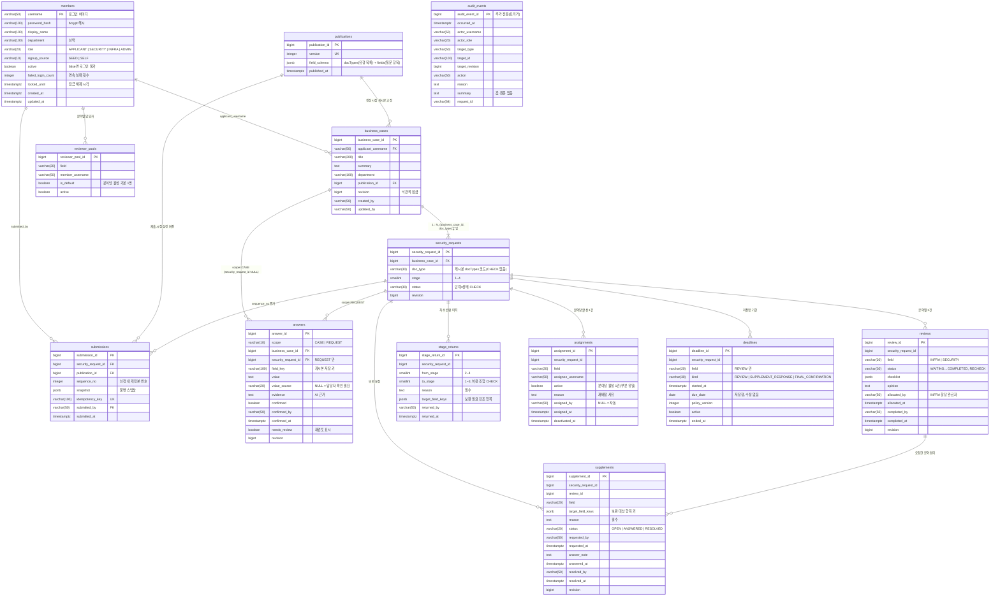
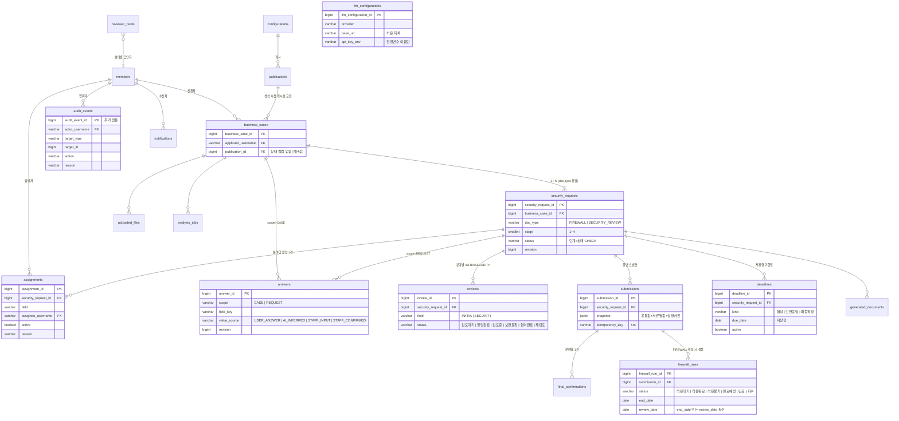

# Security-Advisor-Back

보안길잡이(SecurityAdvisor) 백엔드 — Spring Boot 4.1 · Java 25 · PostgreSQL 17 · Flyway · Gradle(Kotlin DSL) · Lombok(허용 목록만, `lombok.config`로 강제).
규칙·구조·명령은 팀 Claude 프로젝트의 AGENTS.md를 따른다(저장소 루트 사본은 추후 추가).

## 준비물

- JDK 25 (없으면 Gradle toolchain이 자동으로 내려받는다)
- Docker (개발용 DB와 테스트의 Testcontainers에 필요)
- PostgreSQL 17 — `jdbc:postgresql://localhost:5432/boan` (계정 `boan`/`boan`, `DB_URL`·`DB_USERNAME`·`DB_PASSWORD`로 변경)

## 실행

```bash
cp .env.example .env         # 시연 계정 비밀번호(DEMO_ACCOUNT_PASSWORD) 등 — .env 는 커밋하지 않는다
./gradlew bootRun            # http://localhost:8080 , Swagger UI: /swagger-ui.html
./gradlew spotlessApply check  # 커밋 전 필수: 포맷 + 테스트 + ArchUnit
```

기동 시 `DemoAccountSeeder` 가 역할별 시연 계정 5건(`applicant`·`applicant2`·`security`·`infra`·`admin`, 비밀번호는 `DEMO_ACCOUNT_PASSWORD`)을 bcrypt 해시로 만든다. 비밀번호를 비우면 만들지 않는다. 마이그레이션에는 계정을 넣지 않는다.

## 사업 건·신청 API (F-01·F-03·F-05 일부)

| 요청 | 설명 | 응답 |
|---|---|---|
| `GET /api/publications/current` | 현재 게시본 — 서류 유형 목록(`docTypes`)과 질문 항목(`fields`). 서류 유형은 코드가 아니라 이 데이터가 정한다(ADR 0005) | 200 |
| `POST /api/business-cases` | 사업 건 + 선택한 서류 유형별 신청 생성. `docTypes` 는 현재 게시본 `docTypes` 의 활성 코드(문자열). 사업명·개요·부서는 공통 답변으로, 담당자 항목은 "담당자 확인 필요"로 미리 생성 | 201 + `Location`, 유형 없음 400, 게시본에 없는 유형 422 |
| `GET /api/business-cases?page&size` | 내 사업 건 목록(진행 요약은 하위 신청에서 계산) | 200 |
| `GET /api/business-cases/{id}` | 사업 건 상세 + 공통 답변 + 신청 요약 | 200, 남의 것 404 |
| `PUT /api/business-cases/{id}` | 사업 개요 수정(`expectedRevision`) | 200, 불일치 409 |
| `PUT /api/business-cases/{id}/answers/{fieldKey}` | 공통 항목 사용자 답변(처음이면 `expectedRevision` 생략) | 200, 스키마에 없는 항목 404, 범위 불일치 422 |
| `PUT …/answers/{fieldKey}/confirmation` | AI 제안 값 사용자 확인 | 200 |
| `PUT …/answers/{fieldKey}/staff-check` | 담당자 확인 요청으로 넘김 | 200 |
| `GET /api/security-requests/{id}` | 신청 상세 + 서류별 답변 | 200, 남의 것 404 |
| `PUT /api/security-requests/{id}/answers/{fieldKey}` (+`/confirmation`, `/staff-check`) | 서류별 항목 답변·확인·담당자 확인 요청 | 위와 같음, 제출·종결·철회 후 422 |
| `PUT /api/security-requests/{id}/withdrawal` | 신청 철회(사유 필수) | 200, 종료 상태 422 |

## 협의 요청·배정·기한·감사 API (F-12·F-13·F-14 + 2단계 진입)

| 요청 | 설명 | 응답 |
|---|---|---|
| `POST /api/security-requests/{id}/reviews` | **협의 요청(1→2단계)**: 분야별 협의 생성 + 기본 담당자 자동 배정(같은 사업 건은 같은 담당자 우선, 신청자 본인 제외) + 협의 기한(영업일) 생성 + 감사 이력, 한 트랜잭션 | 201(미배정 분야 목록 포함), 1단계 아님 422, revision 409 |
| `GET /api/security-requests/{id}/reviews` | 분야별 협의 목록 | 200 |
| `GET /api/security-requests/{id}/assignments` | 배정 이력(활성·비활성) | 200 |
| `POST /api/security-requests/{id}/assignments` | 재배정·미배정 수동 배정(기관 관리자, 사유 필수, 담당자 목록의 활성 구성원만). 이전 배정은 비활성으로 보존 | 201, 관리자 아님 403, 규칙 위반 422 |
| `GET /api/assignments/mine` | 내게 배정된 활성 배정(요청함 기본 보기) | 200 |
| `GET /api/security-requests/{id}/deadlines` | 기한 목록. `status`(ON_TRACK·IMMINENT·OVERDUE·ENDED)는 오늘(Asia/Seoul) 기준 계산값 | 200 |
| `GET /api/security-requests/{id}/audit-events` | 처리 이력(이 신청을 대상으로 한 감사 이력, 시간순) | 200 |
| `GET /api/audit-events?targetType&targetId&page&size` | 기관 관리자 전체 감사 조회 | 200, 관리자 아님 403 |

- 모든 응답에 `X-Request-Id` 헤더가 붙고, 오류 ProblemDetail 과 감사 이력의 `requestId` 가 같은 값이다.
- 감사 이력은 업무 변경과 같은 트랜잭션에서 기록되며(기록 실패 = 업무 실패), `audit_events` 는 DB 트리거로 UPDATE·DELETE 를 거부한다. 값·비밀값·원문은 기록하지 않고 항목 키·출처·참조 ID 만 남긴다.
- 기한 정책(영업일 수·공휴일·임박 기준)은 게시본 `deadlinePolicy` 에 있고 사업 건 생성 시점 버전으로 고정된다. 기한 경과는 상태를 바꾸지 않는다.

## 담당자 검토·보완·반환·종결 API (F-04·F-05)

검토 행위는 **그 신청·분야에 활성 배정된 담당자**만 할 수 있다(역할만 맞으면 403). 조회는 신청을 볼 수 있는 사람 누구나. 협의·보완·신청의 `revision` 은 각각 따로 움직이므로 요청 전에 `GET` 으로 최신 값을 읽는다.

| 경로 | 설명 | 응답 |
| --- | --- | --- |
| `GET /api/reviews` | **담당자 요청함** — 내게 활성 배정된 신청의 협의(사업 건 제목·신청자·협의 기한일 포함) | 200 |
| `GET /api/reviews/{id}` | 협의 상세(할당 여부·체크리스트·의견) | 200 |
| `PUT /api/reviews/{id}/answers/{fieldKey}` | **담당자 입력**(출처 STAFF_INPUT) — 예: INFRA 가 출발지·목적지·대상 서버를 할당. scope=CASE 항목은 사업 건에 저장되어 같은 사업 건의 다른 신청에도 보인다. 2단계 협의 중인 신청만 | 200, 미배정 403, 항목 없음 404, 2단계 아님 422 |
| `PUT /api/reviews/{id}/answers/{fieldKey}/confirmation` | **담당자 확인**(출처 STAFF_CONFIRMED) — 사용자 답변·AI 추론 값이 맞다고 확인. 값은 바뀌지 않는다 | 200, 답변 없음 404 |
| `PUT /api/reviews/{id}/allocation-completion` | **INFRA 할당 완료** — 협의 완료가 아니다(불변식 12). SECURITY 완료의 선행 조건 | 200, SECURITY 협의 422 |
| `PUT /api/reviews/{id}/completion` | **분야 협의 완료** — 의견 필수, 분야 체크리스트 전부 `true`(INFRA: source·destination·protocol·port·period / SECURITY: processed_info·external_transfer·access_control·logging), 미해결 보완 없음, SECURITY 는 INFRA 할당 완료 이후. 필요한 분야가 모두 완료되면 신청이 **3단계 최종 검토**로 넘어가고 협의 기한이 종료된다 | 200, 규칙 위반 422, revision 409 |
| `POST /api/reviews/{id}/supplements` | **보완 요청** — 대상 항목 1개 이상 + 사유 필수. 신청 상태 → 보완 요청(단계 유지), 대상 답변 `needsReview=true`(값 보존), 보완 응답 기한 재산정 | 201 + `Location`, 완료된 협의 422 |
| `POST /api/supplements/{id}/answers` | **신청자 보완 답변** — 항목 값은 답변 API 로 먼저 고친 뒤 호출. 협의의 미해결 보완이 없으면 협의·신청 상태가 원래대로, 보완 응답 기한 종료 | 201, 남의 신청 404, 본인 아님 403 |
| `GET /api/security-requests/{id}/supplements` | 보완 요청 목록 | 200 |
| `POST /api/security-requests/{id}/stage-returns` | **차수 반환**(2→1, 3→2, 3→1, 4→3) — 사유 필수, `fieldKeys` 로 지정한 항목만 "보완 필요" 강조(기존 값 보존), 완료된 협의는 재검토(RECHECK)로, 협의·최종 확정 기한 종료 + 보완 응답 기한 생성. 어느 분야든 배정 담당자 | 201, 허용되지 않는 반환 422 |
| `GET /api/security-requests/{id}/stage-returns` | 차수 반환 이력 | 200 |
| `PUT /api/security-requests/{id}/closure` | **종결(반려)** — 사유 필수, 모든 활성 기한 종료, 이후 전이 불가. 같은 사업 건의 다른 신청은 영향 없음 | 200, 종료 상태 422 |

- 사용자가 답변을 바꾸면(`PUT …/answers/{fieldKey}`) 영향받는 미제출 신청의 **완료된 협의가 재검토로** 돌아간다(불변식 7). request 컨텍스트가 `AnswerChangedEvent` 를 내고 review 컨텍스트가 같은 트랜잭션에서 받는다.
- 보완 답변·협의 완료 시 ANSWERED 보완은 RESOLVED 로 해소된다. 제출(F-07)은 OPEN 보완이 없어야 한다.

제출·최종 확인·확정·문서함(F-07)은 다음 단계에서 추가한다. 제출 전 검사(`SecurityRequest.submit`)와 상태 전이 규칙은 이미 도메인에 있다.

## 인증 API (F-11)

| 요청 | 설명 | 응답 |
|---|---|---|
| `POST /api/members` | 회원가입(익명). 아이디·비밀번호·표시 이름·부서(선택). 역할은 요청과 무관하게 APPLICANT | 201 + `Location`, 중복 409, 형식 400 |
| `POST /api/auth/login` | 로그인(세션 쿠키 발급) | 200, 실패 401, 잠김 429 |
| `POST /api/auth/logout` | 로그아웃 | 204 |
| `GET /api/auth/me` | 현재 사용자 | 200, 미로그인·만료 401 |

- **CSRF:** 상태 변경 요청(POST 등)은 `XSRF-TOKEN` 쿠키 값을 `X-XSRF-TOKEN` 헤더로 보내야 한다(로그인·회원가입 포함). 쿠키는 아무 GET 응답(예: `GET /api/auth/me`, 401이어도)에 실려 온다. 없거나 틀리면 403.
- **로그인 실패 제한:** 연속 `LOGIN_MAX_FAILURES`(기본 5)회 실패하면 `LOGIN_LOCK_DURATION`(기본 15분) 동안 429. 성공하면 초기화.
- 오류는 전부 ProblemDetail(JSON).

## 현재 구현 범위

- `auth`: 회원가입·세션 로그인·로그인 실패 잠금·CSRF, 역할 4종, 환경변수 비밀번호로 만드는 시연 계정 5건
- `request`: 사업 건(BusinessCase)·신청(SecurityRequest)·답변(Answer, 출처 4종)·제출본(Submission) 애그리거트와 단계×상태 전이 규칙, 신청자 API
- `configuration`: seed 게시본(서류 유형 목록 + 필드 스키마 + 기한 정책) 조회 — 서류 유형은 데이터로 정의(docs/adr/0005)
- `review`: 협의 요청(1→2단계), 담당자 입력·확인, INFRA 할당 완료, 분야 체크리스트·의견·협의 완료(INFRA 선행), 보완 요청·답변, 차수 반환, 종결(F-04·F-05)
- `assignment`: 분야별 담당자 목록(seed)·자동 배정·재배정(F-12)
- `audit`: 추가 전용 감사 이력 기록·조회(F-14)
- 처리 기한(F-13): `request.Deadline` + `common.calendar.BusinessCalendar`(영업일)
- `procedure`: 예제 기능(절차 목록 조회)
- `common`: ProblemDetail 오류 처리, Spring Security 설정, JPA Auditing, ArchUnit 패키지 규칙

시연 계정·비밀번호는 합성 데이터이며 운영 값이 아니다. 비밀값은 환경변수로만 받는다.

## DB 명세

규칙 문서와 의도적으로 다른 결정은 `docs/DEVIATIONS.md`, 기술 결정은 `docs/adr/` 에 있다.

스키마는 Flyway 마이그레이션(`src/main/resources/db/migration/`)으로만 바꾼다. JPA는 `ddl-auto: validate`로 엔티티와 테이블이 맞는지만 확인한다. main에 머지된 마이그레이션 파일은 수정하지 않고 새 파일(`V<연월일시분>__<설명>.sql`)을 추가한다. **외래 키 제약(FOREIGN KEY)은 두지 않는다**(팀 결정 2026-11-07, 성능·운영 단순화). 참조 무결성은 도메인·서비스가 지키고, ERD의 `FK` 표기와 관계선은 논리적 참조를 뜻한다. 참조 컬럼에는 조회용 인덱스를 둔다. 업무 규칙을 담은 CHECK·UNIQUE(단계×상태 조합, 사업 건당 서류 유형 1건, 답변 유일, 멱등성 키 등)는 유지한다. 테이블·컬럼은 snake_case, 테이블명은 복수형이다. **기본 키 컬럼 이름은 맨 `id`를 쓰지 않고 `<테이블 단수형>_id`로 짓는다**(예: `procedures.procedure_id`, `business_cases.business_case_id`). 이렇게 하면 다른 테이블의 외래 키(`security_requests.business_case_id`)와 이름·형식이 같아지며, **같은 이름의 컬럼은 모든 테이블에서 같은 의미·같은 데이터 형식**이어야 한다(예: `business_case_id`는 어디서나 BIGINT, `created_by`는 어디서나 VARCHAR(50) username). `members`의 기본 키는 로그인 아이디 `username`(VARCHAR(50))이고, 이를 참조하는 컬럼도 같은 형식에 `_username` 접미사를 쓴다(`applicant_username`, `created_by`는 예외로 유지). 운영 기관은 설치당 1곳 고정이라 기관 테이블과 기관 키 컬럼은 없다(FUNCTIONAL_SPEC.md 3-4장).

### ERD — 현재 (마이그레이션 5건: members · publications · 사업 건/신청/답변/제출본 · 협의/배정/기한/감사 · 보완/차수 반환)



### ERD — 예정 (FUNCTIONAL_SPEC.md 8-1 스키마 확정 기준, 아직 없는 테이블 — 컬럼은 대표 항목만)



### 공통 컬럼

모든 테이블은 `BaseTimeEntity`의 `created_at`·`updated_at`(TIMESTAMPTZ, JPA Auditing이 자동 기록)을 가진다. 담당자·시각을 남겨야 하는 업무 테이블은 `BaseAuditEntity`로 `created_by`·`updated_by`(VARCHAR(50), 로그인 username)를 추가한다.

### 예정 테이블

FUNCTIONAL_SPEC.md 8-1 스키마 확정 체크리스트 기준으로 `business_cases`·`security_requests`·`answers`·`uploaded_files`·`analysis_jobs`·`submissions`·`reviews`·`supplements`·`stage_returns`(이상 생성됨)·`final_confirmations`·`generated_documents`·`configurations`·`publications`·`reviewer_pools`·`assignments`·`deadlines`·`audit_events`·`firewall_rules`·`notifications`·`knowledge_sources`·`private_contexts`·`llm_configurations`를 마이그레이션으로 추가한다. 이 README의 표는 마이그레이션이 늘 때마다 같은 PR에서 갱신한다.
