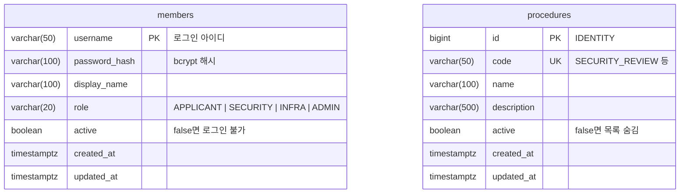
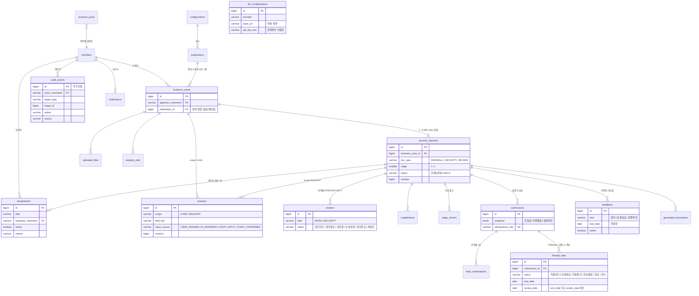

# Security-Advisor-Back

보안길잡이(SecurityAdvisor) 백엔드 — Spring Boot 4.1 · Java 25 · PostgreSQL 17 · Flyway · Gradle(Kotlin DSL).
규칙·구조·명령은 팀 Claude 프로젝트의 AGENTS.md를 따른다(저장소 루트 사본은 추후 추가).

## 준비물

- JDK 25 (없으면 Gradle toolchain이 자동으로 내려받는다)
- Docker (개발용 DB와 테스트의 Testcontainers에 필요)
- PostgreSQL 17 — `jdbc:postgresql://localhost:5432/boan` (계정 `boan`/`boan`, `DB_URL`·`DB_USERNAME`·`DB_PASSWORD`로 변경)

## 실행

```bash
./gradlew bootRun            # http://localhost:8080 , Swagger UI: /swagger-ui.html
./gradlew spotlessApply check  # 커밋 전 필수: 포맷 + 테스트 + ArchUnit
```

## 현재 구현 범위

- `auth`: 시연용 세션 로그인(`POST /api/auth/login`, `/logout`, `GET /api/auth/me`), 역할 4종, 시연 계정 seed
- `procedure`: 예제 기능(절차 목록 조회)
- `common`: ProblemDetail 오류 처리, Spring Security 설정, JPA Auditing, ArchUnit 패키지 규칙

시연 계정·비밀번호는 합성 데이터이며 운영 값이 아니다. 비밀값은 환경변수로만 받는다.

## DB 명세

스키마는 Flyway 마이그레이션(`src/main/resources/db/migration/`)으로만 바꾼다. JPA는 `ddl-auto: validate`로 엔티티와 테이블이 맞는지만 확인한다. main에 머지된 마이그레이션 파일은 수정하지 않고 새 파일(`V<연월일시분>__<설명>.sql`)을 추가한다. 테이블·컬럼은 snake_case, 테이블명은 복수형이다. 운영 기관은 설치당 1곳 고정이라 기관 테이블과 기관 키 컬럼은 없다(FUNCTIONAL_SPEC.md 3-4장).

### ERD — 현재 (마이그레이션 2건)



### ERD — 예정 (FUNCTIONAL_SPEC.md 8-1 스키마 확정 기준, 컬럼은 대표 항목만)



### 공통 컬럼

모든 테이블은 `BaseTimeEntity`의 `created_at`·`updated_at`(TIMESTAMPTZ, JPA Auditing이 자동 기록)을 가진다. 담당자·시각을 남겨야 하는 업무 테이블은 `BaseAuditEntity`로 `created_by`·`updated_by`(VARCHAR(50), 로그인 username)를 추가한다.

### members — 사용자 계정 (`V202611070900__create_members.sql`)

| 컬럼 | 타입 | 제약 | 설명 |
|---|---|---|---|
| username | VARCHAR(50) | PK | 로그인 아이디. 다른 테이블의 `created_by` 등이 이 값으로 사용자를 참조 |
| password_hash | VARCHAR(100) | NOT NULL | bcrypt 해시(`{bcrypt}$2b$…`, DelegatingPasswordEncoder 형식). 평문 저장 금지 |
| display_name | VARCHAR(100) | NOT NULL | 화면 표시 이름 |
| role | VARCHAR(20) | NOT NULL, CHECK IN (APPLICANT, SECURITY, INFRA, ADMIN) | 역할 4종. 계정당 1개 |
| active | BOOLEAN | NOT NULL DEFAULT TRUE | false면 로그인 불가. 이력이 참조하므로 삭제 대신 비활성화 |
| created_at / updated_at | TIMESTAMPTZ | NOT NULL DEFAULT now() | 공통 컬럼 |

seed: 시연 계정 4건(`applicant`·`security`·`infra`·`admin`, 역할별 1건) — 전부 합성 데이터. 비밀번호를 환경변수로 받아 해시하는 방식(F-11)과 부서·가입 경로·로그인 실패 횟수·잠금 시각 컬럼, 신청자 2번째 계정은 후속 마이그레이션으로 추가 예정.

### procedures — 보안 절차 종류 (`V202611041300__create_procedures.sql`, 예제 기능)

| 컬럼 | 타입 | 제약 | 설명 |
|---|---|---|---|
| id | BIGINT | PK, IDENTITY | 내부 식별자 |
| code | VARCHAR(50) | NOT NULL, UNIQUE | 절차 고정 코드. API·화면에서 id 대신 사용 |
| name | VARCHAR(100) | NOT NULL | 표시 이름 |
| description | VARCHAR(500) | | 설명 |
| active | BOOLEAN | NOT NULL DEFAULT TRUE | false면 목록에서 숨김(삭제하지 않음) |
| created_at / updated_at | TIMESTAMPTZ | NOT NULL DEFAULT now() | 공통 컬럼 |

seed: `SECURITY_REVIEW`·`FIREWALL_REQUEST`·`USB_REQUEST` 3건. 이 테이블은 패키지 구조 예제이며, 1차 범위의 서류 유형은 FUNCTIONAL_SPEC.md의 `DocType`(FIREWALL / SECURITY_REVIEW)으로 정리될 예정이다(USB는 범위 밖).

### 예정 테이블

FUNCTIONAL_SPEC.md 8-1 스키마 확정 체크리스트 기준으로 `business_cases`·`security_requests`·`answers`·`uploaded_files`·`analysis_jobs`·`submissions`·`reviews`·`supplements`·`stage_returns`·`final_confirmations`·`generated_documents`·`configurations`·`publications`·`reviewer_pools`·`assignments`·`deadlines`·`audit_events`·`firewall_rules`·`notifications`·`knowledge_sources`·`private_contexts`·`llm_configurations`를 마이그레이션으로 추가한다. 이 README의 표는 마이그레이션이 늘 때마다 같은 PR에서 갱신한다.
