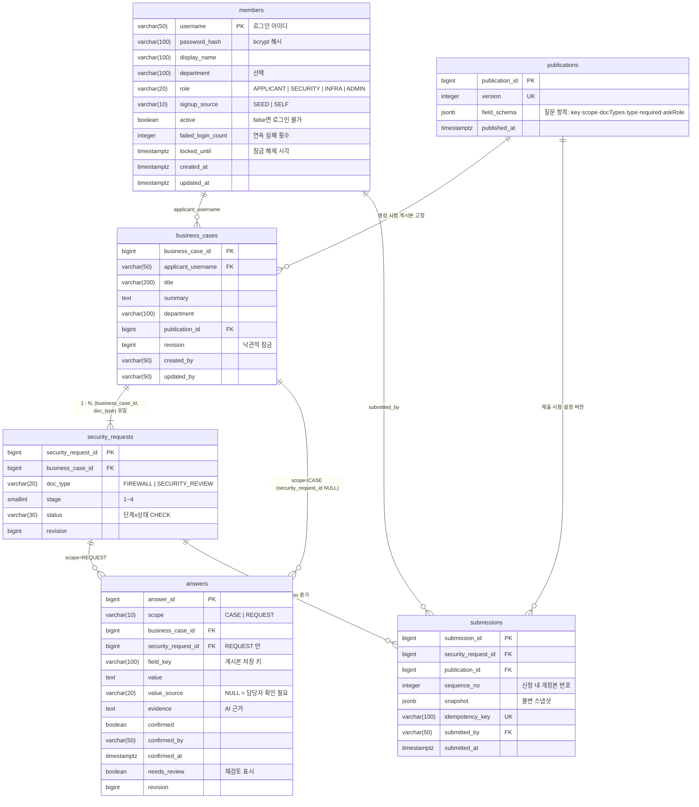

# Security-Advisor-Back

보안길잡이(SecurityAdvisor) 백엔드 — Spring Boot 4.1 · Java 25 · PostgreSQL 17 · Flyway · Gradle(Kotlin DSL).
규칙·구조·명령은 팀 Claude 프로젝트의 AGENTS.md를 따른다(저장소 루트 사본은 추후 추가).

## 준비물

- JDK 25 (없으면 Gradle toolchain이 자동으로 내려받는다)
- Docker (개발용 DB와 테스트의 Testcontainers에 필요)
- PostgreSQL 17 — `jdbc:postgresql://localhost:5432/boan` (계정 `boan`/`boan`, `DB_URL`·`DB_USERNAME`·`DB_PASSWORD`로 변경)

## 실행

```bash
cp .env.example .env         # 시연 계정 비밀번호(DEMO_ACCOUNT_PASSWORD) 등 — .env 는 커밋하지 않는다
./gradlew bootRun            # http://localhost:8080 , Swagger UI: /swagger-ui.html
./gradlew spotlessApply check  # 커밋 전 필수: 포맷 + 테스트 + ArchUnit
```

기동 시 `DemoAccountSeeder` 가 역할별 시연 계정 5건(`applicant`·`applicant2`·`security`·`infra`·`admin`, 비밀번호는 `DEMO_ACCOUNT_PASSWORD`)을 bcrypt 해시로 만든다. 비밀번호를 비우면 만들지 않는다. 마이그레이션에는 계정을 넣지 않는다.

## 사업 건·신청 API (F-01·F-03·F-05 일부)

| 요청 | 설명 | 응답 |
|---|---|---|
| `GET /api/publications/current` | 현재 게시본(질문 항목 스키마) | 200 |
| `POST /api/business-cases` | 사업 건 + 선택한 서류 유형별 신청 생성. 사업명·개요·부서는 공통 답변으로, 담당자 항목은 "담당자 확인 필요"로 미리 생성 | 201 + `Location`, 유형 없음 400 |
| `GET /api/business-cases?page&size` | 내 사업 건 목록(진행 요약은 하위 신청에서 계산) | 200 |
| `GET /api/business-cases/{id}` | 사업 건 상세 + 공통 답변 + 신청 요약 | 200, 남의 것 404 |
| `PUT /api/business-cases/{id}` | 사업 개요 수정(`expectedRevision`) | 200, 불일치 409 |
| `PUT /api/business-cases/{id}/answers/{fieldKey}` | 공통 항목 사용자 답변(처음이면 `expectedRevision` 생략) | 200, 스키마에 없는 항목 404, 범위 불일치 422 |
| `PUT …/answers/{fieldKey}/confirmation` | AI 제안 값 사용자 확인 | 200 |
| `PUT …/answers/{fieldKey}/staff-check` | 담당자 확인 요청으로 넘김 | 200 |
| `GET /api/security-requests/{id}` | 신청 상세 + 서류별 답변 | 200, 남의 것 404 |
| `PUT /api/security-requests/{id}/answers/{fieldKey}` (+`/confirmation`, `/staff-check`) | 서류별 항목 답변·확인·담당자 확인 요청 | 위와 같음, 제출·종결·철회 후 422 |
| `PUT /api/security-requests/{id}/withdrawal` | 신청 철회(사유 필수) | 200, 종료 상태 422 |

협의 요청(1→2단계)·할당·협의 완료·보완·차수 반환·종결·제출·최종 확인·확정은 review 컨텍스트(다음 단계)에서 추가한다. 제출 전 검사(`SecurityRequest.submit`)와 상태 전이 규칙은 이미 도메인에 있다.

## 인증 API (F-11)

| 요청 | 설명 | 응답 |
|---|---|---|
| `POST /api/members` | 회원가입(익명). 아이디·비밀번호·표시 이름·부서(선택). 역할은 요청과 무관하게 APPLICANT | 201 + `Location`, 중복 409, 형식 400 |
| `POST /api/auth/login` | 로그인(세션 쿠키 발급) | 200, 실패 401, 잠김 429 |
| `POST /api/auth/logout` | 로그아웃 | 204 |
| `GET /api/auth/me` | 현재 사용자 | 200, 미로그인·만료 401 |

- **CSRF:** 상태 변경 요청(POST 등)은 `XSRF-TOKEN` 쿠키 값을 `X-XSRF-TOKEN` 헤더로 보내야 한다(로그인·회원가입 포함). 쿠키는 아무 GET 응답(예: `GET /api/auth/me`, 401이어도)에 실려 온다. 없거나 틀리면 403.
- **로그인 실패 제한:** 연속 `LOGIN_MAX_FAILURES`(기본 5)회 실패하면 `LOGIN_LOCK_DURATION`(기본 15분) 동안 429. 성공하면 초기화.
- 오류는 전부 ProblemDetail(JSON).

## 현재 구현 범위

- `auth`: 회원가입·세션 로그인·로그인 실패 잠금·CSRF, 역할 4종, 환경변수 비밀번호로 만드는 시연 계정 5건
- `request`: 사업 건(BusinessCase)·신청(SecurityRequest)·답변(Answer, 출처 4종)·제출본(Submission) 애그리거트와 단계×상태 전이 규칙, 신청자 API
- `configuration`: seed 게시본(필드 스키마) 조회
- `procedure`: 예제 기능(절차 목록 조회)
- `common`: ProblemDetail 오류 처리, Spring Security 설정, JPA Auditing, ArchUnit 패키지 규칙

시연 계정·비밀번호는 합성 데이터이며 운영 값이 아니다. 비밀값은 환경변수로만 받는다.

## DB 명세

스키마는 Flyway 마이그레이션(`src/main/resources/db/migration/`)으로만 바꾼다. JPA는 `ddl-auto: validate`로 엔티티와 테이블이 맞는지만 확인한다. main에 머지된 마이그레이션 파일은 수정하지 않고 새 파일(`V<연월일시분>__<설명>.sql`)을 추가한다. 테이블·컬럼은 snake_case, 테이블명은 복수형이다. **기본 키 컬럼 이름은 맨 `id`를 쓰지 않고 `<테이블 단수형>_id`로 짓는다**(예: `procedures.procedure_id`, `business_cases.business_case_id`). 이렇게 하면 다른 테이블의 외래 키(`security_requests.business_case_id`)와 이름·형식이 같아지며, **같은 이름의 컬럼은 모든 테이블에서 같은 의미·같은 데이터 형식**이어야 한다(예: `business_case_id`는 어디서나 BIGINT, `created_by`는 어디서나 VARCHAR(50) username). `members`의 기본 키는 로그인 아이디 `username`(VARCHAR(50))이고, 이를 참조하는 컬럼도 같은 형식에 `_username` 접미사를 쓴다(`applicant_username`, `created_by`는 예외로 유지). 운영 기관은 설치당 1곳 고정이라 기관 테이블과 기관 키 컬럼은 없다(FUNCTIONAL_SPEC.md 3-4장).

### ERD — 현재 (마이그레이션 3건: members · publications · 사업 건/신청/답변/제출본)



### ERD — 예정 (FUNCTIONAL_SPEC.md 8-1 스키마 확정 기준, 아직 없는 테이블 — 컬럼은 대표 항목만)

```mermaid
erDiagram
    members ||--o{ business_cases : "신청자"
    members ||--o{ assignments : "담당자"
    members ||--o{ audit_events : "행위자"
    members ||--o{ notifications : "수신자"
    publications ||--o{ business_cases : "생성 시점 게시본 고정"
    configurations ||--o{ publications : "게시"
    business_cases ||--|{ security_requests : "1 : N (doc_type 유일)"
    business_cases ||--o{ answers : "scope=CASE"
    business_cases ||--o{ uploaded_files : ""
    business_cases ||--o{ analysis_jobs : ""
    security_requests ||--o{ answers : "scope=REQUEST"
    security_requests ||--o{ reviews : "분야별 INFRA/SECURITY"
    security_requests ||--o{ supplements : ""
    security_requests ||--o{ stage_returns : "사유 필수"
    security_requests ||--o{ submissions : "불변 스냅샷"
    security_requests ||--o{ assignments : "분야당 활성 1건"
    security_requests ||--o{ deadlines : "저장형 기한일"
    security_requests ||--o{ generated_documents : ""
    submissions ||--o{ final_confirmations : "분야별 1건"
    submissions ||--o{ firewall_rules : "FIREWALL 확정 시 생성"
    reviewer_pools }o--|| members : "분야별 담당자"

    business_cases {
        bigint  business_case_id PK
        varchar applicant_username FK
        bigint  publication_id FK "상태 컬럼 없음(계산값)"
    }
    security_requests {
        bigint  security_request_id PK
        bigint  business_case_id FK
        varchar doc_type "FIREWALL | SECURITY_REVIEW"
        smallint stage "1~4"
        varchar status "단계x상태 CHECK"
        bigint  revision
    }
    answers {
        bigint  answer_id PK
        varchar scope "CASE | REQUEST"
        varchar field_key
        varchar value_source "USER_ANSWER | AI_INFERRED | STAFF_INPUT | STAFF_CONFIRMED"
        bigint  revision
    }
    reviews {
        bigint  review_id PK
        bigint  security_request_id FK
        varchar field "INFRA | SECURITY"
        varchar status "검토대기 | 할당완료 | 검토중 | 보완요청 | 협의완료 | 재검토"
    }
    submissions {
        bigint  submission_id PK
        bigint  security_request_id FK
        jsonb   snapshot "공통값+서류별값+설정버전"
        varchar idempotency_key UK
    }
    assignments {
        bigint  assignment_id PK
        bigint  security_request_id FK
        varchar field
        varchar assignee_username FK
        boolean active
        varchar reason
    }
    deadlines {
        bigint  deadline_id PK
        bigint  security_request_id FK
        varchar kind "협의 | 보완응답 | 최종확정"
        date    due_date "저장형"
        boolean active
    }
    audit_events {
        bigint  audit_event_id PK "추가 전용"
        varchar actor_username FK
        varchar target_type
        bigint  target_id
        varchar action
        varchar reason
    }
    firewall_rules {
        bigint  firewall_rule_id PK
        bigint  submission_id FK
        varchar status "적용대기 | 적용완료 | 적용불가 | 만료예정 | 만료 | 회수"
        date    end_date
        date    review_date "end_date 또는 review_date 필수"
    }
    llm_configurations {
        bigint  llm_configuration_id PK
        varchar provider
        varchar base_url "허용 목록"
        varchar api_key_env "환경변수 이름만"
    }
```



### 공통 컬럼

모든 테이블은 `BaseTimeEntity`의 `created_at`·`updated_at`(TIMESTAMPTZ, JPA Auditing이 자동 기록)을 가진다. 담당자·시각을 남겨야 하는 업무 테이블은 `BaseAuditEntity`로 `created_by`·`updated_by`(VARCHAR(50), 로그인 username)를 추가한다.

### 예정 테이블

FUNCTIONAL_SPEC.md 8-1 스키마 확정 체크리스트 기준으로 `business_cases`·`security_requests`·`answers`·`uploaded_files`·`analysis_jobs`·`submissions`·`reviews`·`supplements`·`stage_returns`·`final_confirmations`·`generated_documents`·`configurations`·`publications`·`reviewer_pools`·`assignments`·`deadlines`·`audit_events`·`firewall_rules`·`notifications`·`knowledge_sources`·`private_contexts`·`llm_configurations`를 마이그레이션으로 추가한다. 이 README의 표는 마이그레이션이 늘 때마다 같은 PR에서 갱신한다.
